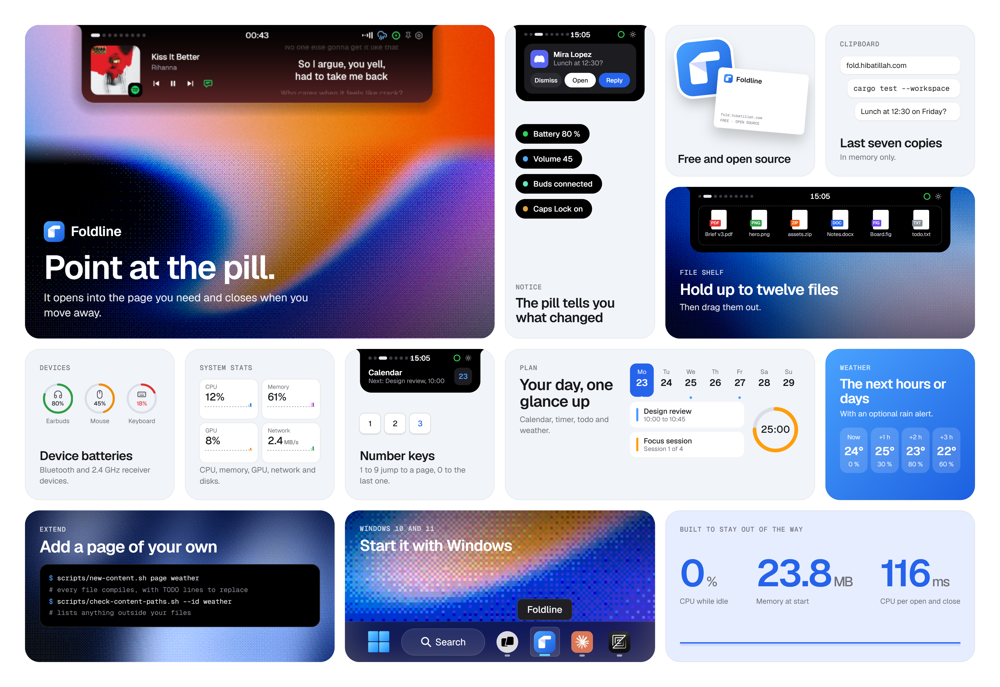

# Foldline


Foldline puts a slim black pill at the top of your Windows screen. Point at it and it opens into a media player with synced lyrics, a file shelf, a calendar, a focus timer, prayer times and more. Short messages (volume, notifications, Caps Lock) appear in the pill while they happen.

It is written in Rust and draws straight to the screen with Direct2D: no UI framework, no web view. It idles at 0 % CPU and stays under 50 MB of memory. Foldline is free and open source, with no account and no paid tier.



## Make it yours

Add a page, an activity or the settings of a page without touching the rest of the app. Each lives in its own folder, a scaffold sets it up, an agent can build it from a description, and a script proves your pull request changes only your own files. Give your agent this prompt, or run `/add-content` in Claude Code:

```
Add a <page | activity | page with settings> to Foldline that <what it should do>.
Follow AGENTS.md, section "Contribute your own content".
```

The steps by hand are in [add your own content](docs/how-to/add-your-content.md), and [CONTRIBUTING.md](CONTRIBUTING.md) holds the agreement.

## Install

Requirements: Windows 10 or 11, 64-bit (tested on Windows 11). The media page needs a player that appears in the Windows media controls.

- **GitHub releases only:** each release holds the installer and the exe. Foldline is not on the Microsoft Store ([why](docs/explanation/microsoft-store-attempt.md)).
- **Installer:** run `foldline-v<version>-windows-x64-setup.exe` from the GitHub releases. It is not code-signed, so Windows shows "Windows protected your PC" (SmartScreen): choose **More info**, then **Run anyway**. A stable installer offers **Start Foldline when Windows starts** (on by default). To update, click **Check for updates** on the settings window's About page (it compares your version with the latest release and, when one is newer, **Download** opens the release page), or run a newer installer, and it asks before replacing the installed copy. A pre-release (`1.1.0-beta.1`) installs beside every other copy and never replaces one. The rules are in [cut a release](docs/how-to/cut-a-release.md#updating).

## What it includes

Pages are what you see when the notch is open. The time sits in the header of every one.

- **Media:** the current track with synced lyrics, line by line.
- **Shelf:** drop files to keep them for a while (twelve at most).
- **Calendar:** the month or the week, and the events of the day you pick, from an iCal address.
- **Timer:** a focus timer with short and long breaks.
- **Todo:** a list with no limit, with undo for the last removal.
- **Shalat** (off until you add it): prayer times for any city, calculated on your PC.
- **System stats** (off until you add it): CPU, memory, GPUs, network and disks.
- **Weather** (off until you add it): the next hours or days, with an optional alert before rain.
- **Clipboard** (off until you add it): your last 7 copies, kept in memory only.
- **Connected devices** (off until you add it): the battery of Bluetooth and 2.4 GHz receiver devices.

Activities are what the collapsed pill shows while something happens. They cover volume and brightness, charger and battery, Bluetooth devices, microphone and camera in use, "Copied", Caps Lock, Windows notifications and browser downloads. A notification card has Dismiss, Open and quick Reply buttons. What each activity watches is in [activities](docs/reference/activities.md), and how each page looks and behaves is in [design rules](docs/reference/design-rules.md).

## Use it

- **Open and close:** point at the pill to open it, then move away to close it. The pin left of the gear keeps it open, also over maximized and full-screen windows, until you click it again.
- **Switch pages:** scroll, swipe two fingers or click a dot. While the pointer is on the open notch, the number keys 1 to 9 jump to a page, and 0 jumps to the last one. The order is set in Settings.
- **Tray menu:** right-click the tray icon (on Windows 11 it may sit under the `^` menu) for four items. **Snooze notifications** hides banner-style messages and page alerts for 10 minutes, 30 minutes, an hour or until you turn it off. **Pause Foldline** hides the notch completely and gives Windows' own popups back. **Settings** and **Quit Foldline** do what they say.
- **Settings:** the gear in the open notch and the tray's **Settings** item open the settings window. Everything you can change is there. That includes what the notch shows over maximized and full-screen windows, and whether Windows' own volume and brightness popups stay hidden.

## Performance

The same numbers are on the [website](https://fold.hibatillah.com). Measured on 2026-11-22 on Windows 11 with a Ryzen 5 8645HS, as a release build with the shelf page open:

| Measurement | Result |
| --- | ---: |
| Memory at start | 23.8 MB |
| CPU while idle | 0 % |
| CPU per open and close | 116 ms |
| Memory growth over 10 open and close cycles | 0.3 MB |

It is one run on one PC, and it did not cover music playback or live lyrics. The full numbers, limits and how to repeat them are in [performance baseline](docs/reference/performance-baseline.md).

## Limitations

- Windows only, at the top of one screen (main, focused or chosen). Multi-monitor behavior is in [layout](docs/reference/layout.md#where-the-notch-sits-on-several-monitors).
- Microphone and camera show that an app has the device open, not that it is recording.
- **Notification delay in the installer version.** The `-setup.exe` version shows a notification later than Windows does, because Windows doesn't tell it about new ones, so it reads Windows' notification database instead. That usually adds about a third of a second. The first one after start-up takes a few seconds, and some take much longer. A packaged (MSIX) build doesn't have this delay, but no release is packaged, so the installer version is the only build and the delay applies to every release ([why](docs/explanation/notification-delivery.md)).
- The calendar reads an iCal address, not a Google sign-in. Treat the address like a password.
- Prayer times are within a few minutes of published tables. Check them against your local authority before relying on them.

## Privacy

Nothing in the app contacts a Foldline server: no account, no sign-in, no analytics and no automatic update check. Settings, the todo list and the shelf stay in `%APPDATA%Foldline`. Data leaves your PC only when a feature needs it: the update check you click, lyric lookups, an iCal link you set, and the weather of a place you pick. The clipboard page, when switched on, keeps your last seven copies in memory only.

The full policy, with what is sent to whom and how often, is on the website: [Privacy Policy](https://fold.hibatillah.com/privacy). The terms are at [Terms of Service](https://fold.hibatillah.com/terms).

## Contributing

Contributions are welcome through pull requests on [github.com/hibatillah/foldline](https://github.com/hibatillah/foldline). Read [CONTRIBUTING.md](CONTRIBUTING.md) first, because it holds the contributor agreement. To add your own page, activity or page settings, see [add your own content](docs/how-to/add-your-content.md). [ONBOARDING.md](ONBOARDING.md) covers the build, the structure and the rules the code follows, and [docs/README.md](docs/README.md) indexes the documentation. The name and logo are not part of the code license ([TRADEMARK.md](TRADEMARK.md)).

## Acknowledgements

Foldline is inspired by Apple's Dynamic Island. Apple and Dynamic Island are trademarks of Apple Inc. Foldline is not affiliated with or endorsed by Apple.

- **Windows APIs** through the [`windows`](https://crates.io/crates/windows) crate.
- **[LRCLIB](https://lrclib.net)** for synced lyrics.
- **[GeoNames](https://www.geonames.org)** for the city list (cities of 15,000 people or more), under [CC BY 4.0](https://creativecommons.org/licenses/by/4.0/).
- **[MET Norway](https://api.met.no)** (CC BY 4.0) for the weather forecast.
- **[salah](https://crates.io/crates/salah)** (MIT) for prayer times, in `vendor/salah` with one crash fix (`vendor/salah/VENDORED.md`).
- **[Geist](https://vercel.com/font)** for the font and **[Lucide](https://lucide.dev)** (ISC) for some icons.
- **[GPUI](https://www.gpui.rs)** and gpui-component for the settings window.

## License

GNU General Public License, version 3 or later. See [LICENSE](LICENSE). Copyright © 2026 hibatillah. Third-party components keep their own licenses, listed in `THIRD-PARTY-LICENSES.txt` and under **Licenses** on the settings window's About page.
