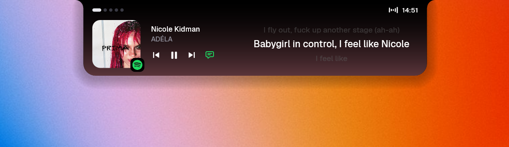

# Notch


Notch puts a slim black pill at the top of your Windows screen. Hover over it and it opens into a media player with synced lyrics, a file shelf, a calendar, a focus timer, prayer times, a todo list and system stats. Short messages (volume, notifications, Caps Lock) appear in the pill while they happen.

It is written in Rust and draws straight to the screen with Direct2D: no UI framework, no web view. It idles at 0 % CPU and stays under 50 MB of memory.



## Install

Run `notch-<version>-windows-x64-setup.exe`. The installer is not code-signed, so Windows may show a SmartScreen warning. Notch starts with Windows unless you untick that in the installer or in the tray menu (**Start with Windows**).

Requirements: Windows 10 or 11, 64-bit (tested on Windows 11). The media page needs a player that appears in the Windows media controls.

**Updating.** Notch does not check for new versions. Run the newer `-setup.exe`: the installer sees the installed copy, says which version it has and which it would put in its place, and asks whether to continue. If you say yes, it closes the running notch, replaces it and starts it again. Your settings stay.

## What it includes

Pages are what you see when you open the notch; the time sits in the header of every one.

- **Media:** the current track with synced lyrics, line by line. With lyrics off, the collapsed pill fits the song title.
- **Shelf:** drop files to keep them for a while.
- **Calendar:** the week and the events of a day you pick.
- **Timer:** a focus timer.
- **Shalat** (off until you add it): prayer times for any city, worked out on your PC with no internet. It shows the next prayer and today's times, puts a mark in the collapsed pill 30 minutes before, and shows a short message when a prayer starts. You choose the city, the calculation method and a few minutes of adjustment per time.
- **Todo:** type a task into the notch, tick it off or delete it. The list is the file `%APPDATA%\notch\todo.txt`.
- **System stats** (off until you add it): CPU, memory, up to 2 GPUs, up to 3 disks and the network.
- **Weather** (off until you add it): the temperature now and the next hours for your location, or the next days (click the left side to switch), and an optional message 30 minutes before rain. The location is the one you pick in the notch's settings panel (the gear, General tab), shared with the prayer times.

Activities are what the collapsed pill shows while something happens: volume, brightness, charger and battery, Bluetooth devices, microphone in use, camera in use, copied to the clipboard, Caps Lock, and Windows notifications. A notification opens the pill into a banner with the app's logo for a few seconds; point at it to keep it on screen. A message that was cut short grows taller to show all its text.

While the notch is open, small marks beside the time show what is going on: a wave while music plays, a ring while a focus timer runs, a crossed speaker while the sound is muted, an arrow while Caps Lock is on.

## Use it

- **Open and close.** Hover over the pill to open it. Move away to close it.
- **Switch pages.** Scroll the wheel, swipe two fingers on a touchpad, or click a dot. A touchpad swipe follows your fingers and centers the nearest page when you stop. Pages loop, and the notch opens on the page you left.
- **Media.** Click the buttons. The speech-bubble button turns lyrics on and off.
- **Shelf.** Drag files onto the notch; it turns blue when it is ready. It shows six places, and the last one shows the overflow count. Double-click a file to open it, drag it out to copy it into another app, and right-click it or press the cross on its corner to remove it from the shelf.
- **Calendar.** Click a day of the week to list its events. Paste your calendar's iCal address into **Settings… > Calendar**, which lists the Google Calendar steps for finding it. Treat the address like a password.
- **Right-click menu.** Right-click anywhere on the open notch for **Settings…**, **Edit pages**, **Start with Windows** and **Quit Notch**. On the shelf, right-clicking a file still removes it.
- **Tray menu.** Right-click the tray icon (on Windows 11 it may sit under the `^` menu): **Notifications**, **Hide when idle**, **Start with Windows**, **Settings…**, **Quit**.
- **Settings in the notch.** While the notch is open, the gear in its header opens a panel. Its first tab holds the open page's own settings, followed by General, Behavior and Pages. On Pages, drag a page by its dotted handle to reorder it, double-click it to remove it, click a dashed one to add it. **Done** closes the panel.
- **Settings window.** **Settings…** in the tray menu opens General, Pages, Behavior, Calendar and Advanced. Toggles apply at once; type a value and press Enter, or click away, to save it.

[docs/reference/settings-keys.md](docs/reference/settings-keys.md) lists every setting and its key.

| Option | Default |
| --- | --- |
| Notifications | On |
| Hide when idle | Off |
| Over a maximized window | Lyrics only |
| Over a full-screen app | Hidden |
| Open on hover over a maximized window | On |
| Open on hover over a full-screen app | On |
| Start with Windows | On in the installer |

Defaults apply when no choice has been saved. Choices saved with older versions carry over.

### Over maximized and full-screen windows

Over a **maximized** window and over a **full-screen** app (a game, a video, an F11 window), the notch follows its own choice for each, from hiding to keeping music visible. Set them in **Settings… > Behavior**. They take precedence over **Hide when idle**. The same section can stop the pointer from opening the notch over either kind of window.

After you unlock Windows or resume from sleep, Notch moves back above app windows and resets hover so the hidden strip can open again. It does not take focus from the app you are using.

## Limitations

- Windows only, on the primary display, centered at the top. Other monitors and display changes while running get no special handling, and the display scale is read once at start-up.
- Microphone and camera show that an app has the device open, not that it is recording. An app that keeps the microphone open while you are muted (Google Meet in a browser) keeps the orange dot. The camera is found through the Windows Frame Server log, so it misses some older DirectShow apps and a camera that was already on at start-up.
- Notifications show a few seconds after Windows shows its own banner, and only as a banner: there is no list of past ones and no buttons. `notifications.show_text=off` in the settings file leaves the text out.
- The calendar reads an iCal address, not a Google sign-in. An event that crosses a daylight-saving change can show an hour off.
- The shelf keeps the paths of files, not copies. Dragging a file out copies it and never moves or deletes the original.
- The open notch is 86 px high for every page, so the calendar lists two events at a time.
- Brightness follows the laptop panel only.
- Prayer times are within a few minutes of published tables. Check them against your local authority before relying on them.
- Notch is at version 0.5: expect rough edges.

## Resource use

The numbers below are the latest recorded run of `scripts/perf.sh`, on 2026-11-03: Windows 11 Home build 26300, Ryzen 5 8645HS, 15.3 GiB RAM, Rust 1.97.1, release build. The test used the shelf page, 20-second idle samples and 10 open/close cycles. CPU is a percentage of one core; RAM is private working set.

| Measurement | Result | Limit |
| --- | ---: | ---: |
| Initial RAM | 24.3 MiB | 30 MiB |
| Collapsed idle CPU | 0 % | 0.1 % |
| CPU time per open/close cycle | 131 ms | 400 ms |
| RAM growth over 10 cycles | 0.6 MiB | 3 MiB |
| Handle growth over 10 cycles | -9 | 20 |
| Hover events | 20 of 20 | exactly 20 |
| Idle CPU after the cycles | 0 % | 0.1 % |

Every gate passed in this run. The run did not measure music playback, live lyrics, held hover or swiping, and one passing run does not guarantee the same result on every machine. The settings window is a separate program with a higher footprint while it is open (about 45 MiB private working set); see [docs/reference/performance-baseline.md](docs/reference/performance-baseline.md).

## Privacy

Notch runs on your computer, with no account and no analytics. Everything below stays on your machine unless it is listed under "Leaves your computer".

**What it reads, locally**

- What is playing, from the Windows media controls.
- The text and app of your Windows notifications.
- Whether the clipboard changed. It never reads what you copied.
- The paths of the files on your shelf, and the todo list in `%APPDATA%\notch\todo.txt`.
- Which window is in front, only to tell whether it is maximized or full screen.
- Caps Lock, through a keyboard hook that looks at that one key and keeps nothing it sees.
- CPU, memory, GPU, disk and network readings for the stats page.
- The location you pick (a city). The city list ships with the app and prayer times are calculated on your PC from it; only the Weather page sends the place's coordinates anywhere (see below).

Settings are in `%APPDATA%\notch\settings.txt`. The installer adds a "Start with Windows" entry under your user's `Run` key unless you untick it.

**Leaves your computer**

- **Lyrics.** When a track starts, Notch asks [LRCLIB](https://lrclib.net) for synced lyrics and sends the artist, title, album and length. The player itself (Spotify, a browser) is only read through Windows, never contacted. Set `NOTCH_LYRICS=off` to stop lookups; the lyrics button only hides them.
- **Calendar.** If you set a calendar link, Notch downloads that file every 15 minutes. The link sits in the settings file, so treat that file like a password.

- **Weather.** Only if you add the Weather page and choose a location: Notch asks the [MET Norway Weather API](https://api.met.no) for the forecast at the coordinates of that place, at start and every half hour, and sends the name "Notch" with its version. Your IP address reaches MET Norway as with any web request; no account and no other data is sent.

## For developers

New to the project? Read [ONBOARDING.md](ONBOARDING.md) for the setup, the structure and the rules the code follows. [AGENTS.md](AGENTS.md) and `.claude/rules/` hold the rules for AI coding agents, and [docs/README.md](docs/README.md) indexes the documentation.

```
cargo build --release
target\x86_64-pc-windows-msvc\release\notch.exe
```

## Acknowledgements

Notch is inspired by Apple's Dynamic Island. Apple and Dynamic Island are trademarks of Apple Inc.; Notch is not affiliated with or endorsed by Apple.

It builds on public APIs and resources:

- **Windows APIs** for media controls, notifications, window events and the tray, through the [`windows`](https://crates.io/crates/windows) crate.
- **[LRCLIB](https://lrclib.net)** for synced lyrics.
- **[GeoNames](https://www.geonames.org)** for the prayer-time city list: cities of 15,000 people or more, reduced to names, countries and coordinates (`scripts/build-cities.sh`), under [Creative Commons Attribution 4.0](https://creativecommons.org/licenses/by/4.0/).
- **[MET Norway](https://api.met.no)** (CC BY 4.0) for the weather forecast: data from the Norwegian Meteorological Institute.
- **[salah](https://crates.io/crates/salah)** (MIT) for the prayer-time calculation, kept in `vendor/salah` with one crash fix (see `vendor/salah/VENDORED.md`). A Jakarta check against Aladhan's Kemenag method was 0 to 2 minutes later.
- **[Geist](https://vercel.com/font)** for the font and **[Lucide](https://lucide.dev)** (ISC) for some icons.
- **[GPUI](https://www.gpui.rs)** and gpui-component for the settings window.
- **iCal** (RFC 5545) calendar addresses, such as the one Google Calendar gives you.

## License

Proprietary. Copyright © 2026 hibatillah. All rights reserved; see [LICENSE](LICENSE). Third-party components keep their own licenses, listed in `THIRD-PARTY-LICENSES.txt` and under **Licenses** in the settings window.
