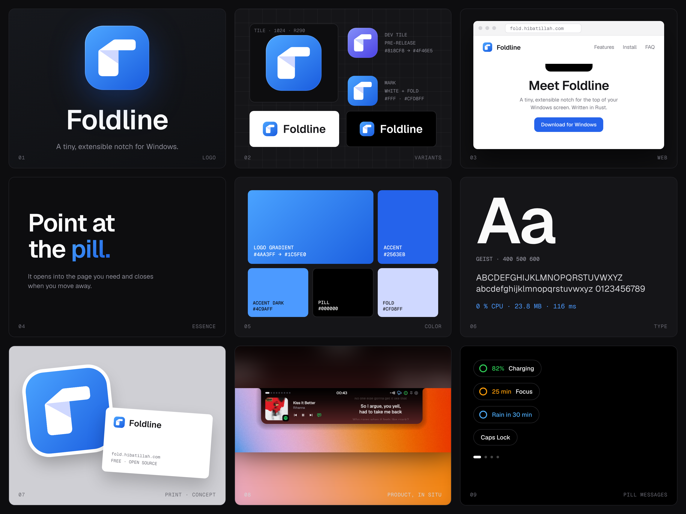

# Foldline brand

Read this to use the Foldline name, logo, colors and type in a page, post or doc. Skip it for app code: the app's own rules are in `docs/reference/design-rules.md`.

The name and logo are not under the code license (see [TRADEMARK.md](../TRADEMARK.md)). This folder collects what already exists in the repository; it adds no new logo or color.

## Name and tone

- **Foldline**, one word, capital F. Always "Foldline", never "FoldLine" or "Fold line".
- Product line: "A tiny, extensible notch for Windows. Written in Rust." (site title and footer)
- Hero: "Meet Foldline". Short imperative lines: "Point at the pill.", "Put the top of your screen to work".
- Voice: plain, short, concrete. Numbers over adjectives ("0 % CPU and 23.8 MB of memory while idle"). Say what leaves the PC. No hype, no exclamation marks.
- Always free: no price, paid tier or ads (`.claude/rules/contributions.md`).

## Logo

A **mark** is the logo without a square. A **tile** is the mark inside the rounded square (`AGENTS.md`).

| File | Use |
| --- | --- |
| `logo/foldline-tile.svg` | Stable tile. Master, copied from `assets/branding/tile-stable.svg` |
| `logo/foldline-tile-dev.svg` | Pre-release tile (indigo). Copy of `tile-dev.svg` |
| `logo/foldline-mark-white.svg` | Mark for use on blue or dark backgrounds |
| `logo/foldline-mark-blue.svg` | Mark for light backgrounds |
| `logo/foldline-mark-ink.svg` | One-color mark, `#18181b` |
| `logo/foldline-lockup-on-light.svg`, `-on-dark.svg` | Tile + "Foldline" wordmark, text outlined |
| `logo/foldline-wordmark-ink.svg`, `-white.svg` | "Foldline" alone, outlined |

Facts from the master SVG: 1024 x 1024 tile, corner radius 290, gradient `#4aa3ff` to `#1c5fe0` from top-left to bottom-right, a 10 px inner highlight stroke, mark in `#ffffff` with a folded corner in `#cfd8ff`. The pre-release tile uses `#818cf8` to `#4f46e5`.

Derived files (marks, lockups, wordmarks) were produced from the master paths and Geist 600; the fold tint in the blue and ink marks (the fold triangle at 55 % opacity) is a derivation, since the master only defines the white mark. Treat the tiles as the only official artwork until the maintainer approves the rest.

Lockup: tile height 1.45 x the text size, gap 0.55 x the text size (as the site's nav: 26 px tile, 18 px text, 10 px gap). Wordmark is Geist 600 with -0.01em tracking.

Rules: do not redraw, recolor, rotate or add effects to the tile. Keep clear space of at least a quarter of the tile's side. Do not use the dev tile for a stable release.

## Color

Tokens: `tokens/foldline.css`, `tokens/foldline.json`.

| Role | Value | Source |
| --- | --- | --- |
| Logo gradient | `#4aa3ff` to `#1c5fe0` | tile SVG |
| Fold | `#cfd8ff` | tile SVG |
| Accent, light | `#2563eb` | website `--primary`, design rules ("one blue accent") |
| Accent, dark | `#4c9aff` | website dark `--primary`, settings palette |
| Ink / muted / border | `#18181b` / `#71717a` / `#e4e4e7` | website landing |
| Pill | black | README, design rules |
| Settings dark card / border | `#1b1b1d` / `#2a2a2e` | `crates/settings/src/palette.rs` |
| Status | ok `#2f9e44`, charging `#30d158`, low `#ff453a`, timer `#ff9e0a`, break `#4dabf7`, Bluetooth `#63e6be`, warning `#e0a53a` | design rules |

Blue is the only accent. Status colors appear only inside notch messages, never as brand decoration.

## Type

- **Geist** (400, 500, 600) for everything; **Geist Mono** (400, 500) on the website for numbers and labels. The app itself uses Geist with tabular figures and does not bundle Geist Mono (design rules).
- Font files in `fonts/` (SIL Open Font License, `Geist-LICENSE.txt`).
- Site scale: nav 18 px / 600 / -0.01em.

## Image direction

Real screenshots of the notch (`assets/images/notch-*.png`): the black pill on a colorful wallpaper, with the music page open. Product first, no stock people, no cloud-like gradients.

## Source of truth and known mismatches

1. The logo comes from `assets/branding/tile-*.svg`; `website/public/logo.svg` is identical to the stable tile.
2. The accent on the site (`#2563eb`) is not the logo's end color (`#1c5fe0`); both are in use. The design rules call `#2563eb` the accent.
3. The design canvas "Notch Island v3" holds the landing page boards and a design system named "hibatillah" (Habib's portfolio tokens: Calloveya display font, near-white background). Its blue matches `#2563eb`, but Calloveya is not used by Foldline.
4. The canvas's landing boards use dark-pill mock colors (`#74c0fc`, `#63e6be`, `#121216`) that differ from the live site's light page; the live site is the reference.
5. The older `mark-cream/charcoal/orange.png` are archive (`AGENTS.md`) and are not part of this kit.
6. The board's "Print" panel is a concept; no printed material exists.
